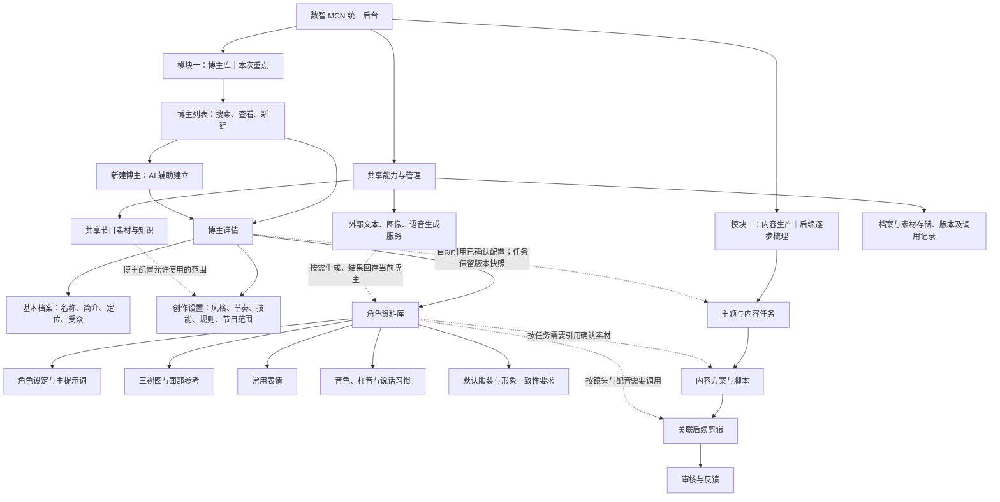
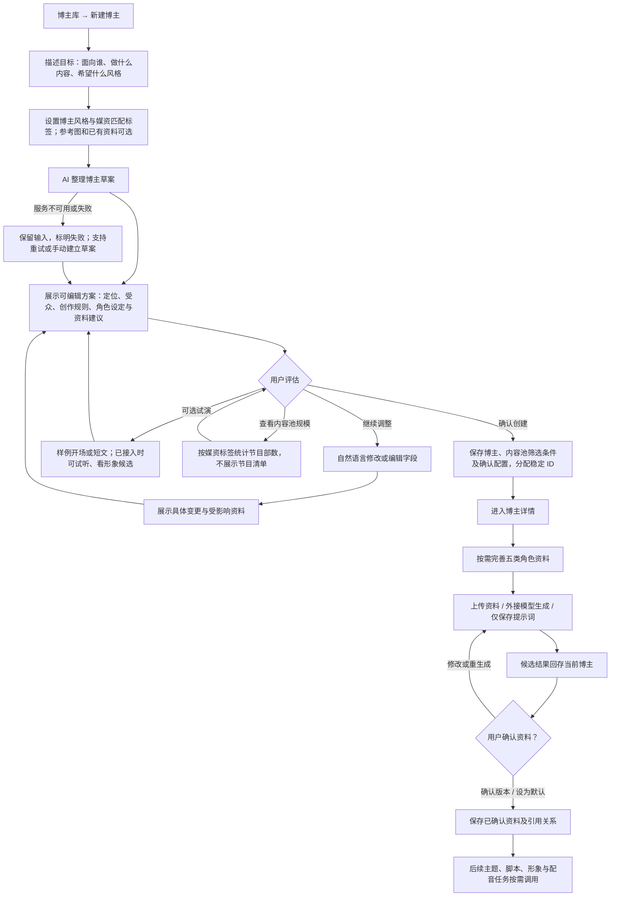
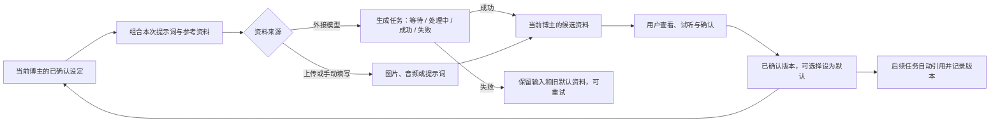

# 数智 MCN 统一后台：产品结构与 AI Native 博主库方案

日期：2026-10-20
更新：2026-10-21，落实内容池匹配与节目数量反馈规则。
状态：产品设计与开发交接依据；本文件新增文档，不代表下列功能已经实现或上线。

## 1. 目标与范围

将云端与本地合并为一套后台，共用页面、字段、操作流程与数据约定，同时支持 Demo 演示及后续真实开发交接。本地、云端是运行环境的差别，不再维护两套相互分叉的产品流程。

后台按两个业务模块组织：① 博主库，管理多个内容 Agent 的长期设定与角色资料；② 内容生产，围绕每次主题组织创作，并关联后续剪辑与审核。本轮先明确并融合博主库。内容生产在总图中表达衔接关系，其详细流程、剪辑与审核规则另行设计。

**核心定位：每位博主是一位可持续复用的内容 Agent，拥有独立的创作设定和角色资料库。**

## 2. 整体产品结构图

下图是目标产品结构；内容生产部分仅展示后续衔接，不表示本次新增或修改全部流程。

共享节目事实、字幕等由素材与知识系统管理；博主引用使用范围。个人创作方法、表达规则和角色设定由博主维护。内容兴趣、创作技能与节目使用范围分别表达，不能混为同一组标签。

## 3. 新建博主：重点流程图

创建入口同时支持自然语言、标签及可选参考图片，提供示例和可点击选项。AI 负责组织配置，表单负责精确编辑；不要求用户面对空白对话自行摸索。

### 3.1 用户输入什么

例如：“建立一个面向中老年的经典影视博主，亲切幽默，重点讲人物处事，声音沉稳。”

最少需要能说明博主的目标；资料不完整时可以先存草稿。受众和表达倾向描述博主；媒资匹配标签描述希望解读的节目范围。角色参考图片和音色资料为可选。创建时不要求五类资料全部生成。

### 3.5 内容池匹配与节目数量（2026-10-21 确认）

流程为：**设定博主风格与解读方式 → 选择媒资匹配标签及内容类型 → 系统形成内容池并统计节目数量 → 保存筛选条件 → 后续从内容池生成适合该博主的选题。**

- 博主风格影响解读视角及选题表达；媒资标签匹配实际节目分类。两类配置分开保存，不把“亲切”“幽默”当作目录中的节目题材。
- 例如选择“古装、历史”及“电视剧、电影”，界面只反馈“覆盖节目：N 部”；不要求列出命中节目、不要求每次标签变化时实时统计。
- 提供“统计节目数量”操作，等待结果时显示统计中；尚未统计或条件变更时显示待统计，失败可重试。无数据源与零命中分别表达，不编造估计数量。
- 第一版规则：所选题材/节目标签同时满足，内容类型任选其一；无选择的条件不限制。界面说明规则，后续可调整匹配策略。
- 数量按稳定节目 ID 去重，不能按 CSV 行数、集数或片段数统计。当前导入 CSV 有 608 行，按 oid 去重有 424 个标识；此为本批目录规模，不代表完成原片接入或可生产资产数。
- 保存的是内容池筛选条件，统计结果带目录版本/统计时间；重新编辑后旧数量标为待更新，防止展示与条件不符的计数。
- 媒资目录匹配不授予素材使用权限。当前生产流程继续遵守已有可用资产与事实资料约束；目录节目只有接入实际素材、事实资料并满足使用条件后，才能进入真实生产。
- 不要求在本次实现跨内容池自动生成选题；本次建立可持久化的内容池定义与统计入口，为后续接入选题提供依据。

### 3.2 AI 做什么

AI 整理可编辑的名称与简介、受众和定位、表达风格、叙述节奏、推荐创作技能、角色设定及资料提示词草案。音色可先给描述或已有音色候选，不凭文字描述虚构可调用音色。

推荐节目范围只能来自系统当前允许使用的资源；生成建议不能授予新的素材使用权限。缺失信息应留待补充，不伪装成已核实事实。

### 3.3 用户确认什么

用户确认博主定位与创作配置后建立档案。形象、音色等生成结果先保存为候选，分别确认后才能成为默认资料。试演是可选环节：可先看开场样文，图像及试听在相应服务可用时提供。

“已创建博主”与“全部资料齐备”分别表达；完整度依据当前任务所需资料判断。缺少三视图不阻止保存档案；配音任务则需要可调用的音色，不能只凭一个声音标签宣称可以配音。

### 3.4 后续如何修改

“成熟一点”“表达更幽默”等指令先生成变更建议，展示哪些字段变化、哪些资料可能需要更新，再由用户确认。只更新受影响部分，不因改写风格而自动替换形象或音色。

已确认形象、声音和角色固定特征保持稳定；需要更换时明确确认。新配置用于后续任务，已执行任务保留当时使用的配置快照。

## 4. 博主详情与五类角色资料

| 页面分区 | 保存内容 | 主要操作 |
|---|---|---|
| 基本档案 | 名称、简介、身份/定位、受众、内容方向、代表头像引用 | 查看、编辑、确认 |
| 创作设置 | 表达风格、节奏、创作技能、补充要求、禁用表达 | AI 建议、手动调整、保存版本 |
| 内容池设置 | 媒资匹配标签、内容类型、统计状态和覆盖节目部数 | 保存筛选条件、按需统计数量；不要求节目清单 |
| 角色资料库 | 下述五类角色资料 | 保存提示词、上传、生成候选、试听、确认与选择默认 |

互动时段仅在需要互动服务的博主中作为可选设置。每期主题、目标时长及具体生产参数属于内容任务，不放进长期角色设定。

| 角色资料分类 | 最小保存内容 | 后续用途 |
|---|---|---|
| 角色设定与主提示词 | 角色身份、性格、固定特征、主提示词、可选参考资料 | 提供角色生成与表达约束 |
| 三视图与面部参考 | 三视图提示词、参考图、上传/生成结果、确认版本 | 保持正面、侧面、背面及面部一致 |
| 常用表情 | 表情名称、提示词、参考图与候选结果 | 按内容和镜头需要选取 |
| 音色、样音与说话习惯 | 音色名称和描述、平台、音色 ID、试听样音、语速、停顿和口头习惯 | 保持声音身份与说话方式 |
| 默认服装与形象一致性要求 | 默认服装描述或参考图、固定特征、一致性约束 | 约束不同镜头及批次的角色形象 |

**第一版允许只保存提示词。** 生成可以外接大模型；不必先建设完整影视资产生产系统，才能建立博主资料库。

代表头像引用资料库中选定的图片；默认音色引用资料库中选定的音色记录，避免多个页面各存一份互相冲突的数据。声音身份与表达风格分别保存。

## 5. 资料生成、确认与复用

### 数据与状态约定

- 每位博主有稳定 ID；每条资料关联所属博主、类型、来源、版本及时间，不按名称直接关联，避免多人串资料。
- 档案草稿、已保存配置、资料候选与已确认版本分别管理；生成任务的运行状态另行记录。
- 点击生成不会立即替换已确认默认资料；生成失败或用户取消时保留旧资料。
- 手动编辑、用户上传、模型生成和演示预置结果均记录来源；参考资料与生成结果分别保存。
- 外部模型及凭据由服务配置管理，普通博主档案只保存调用所需的业务引用，不保存密钥。
- 确认版本供后续任务自动读取；具体任务保留输入与版本快照，便于复现及交接。

## 6. 本地与云端如何融合

以下“现状”依据本轮对已有工程及云端来源的梳理；用于说明融合取舍，不视为后续版本永久状态。

| 方面 | 云端现状 | 本地现状 | 统一目标 |
|---|---|---|---|
| 建立与浏览 | 标签选择、档案预览、矩阵展示 | 可维护页面模块与真实档案配置 | 统一创建和详情，保留易理解的标签体验 |
| 名称与简介 | 当前主要是模板/组合样例 | 已有真实生成路径 | 真实服务返回草案；演示样例明确来源 |
| 数据保存 | 主要使用浏览器存储 | 已有档案 API、文件持久化与版本 | 统一档案服务；云端部署持久化能力 |
| 创作规则 | 以标签和演示配置为主 | 已有受众、表达规则、方法绑定和节目范围 | 统一字段，区分风格、技能及节目知识 |
| 形象与声音 | 头像样例、音色选择 | 现有头像和声音配置 | 以五类角色资料统一保存与引用 |
| 角色资料库 | 尚无完整五类资料管理 | 尚无完整五类资料管理 | 分阶段新增，先支持提示词及已有资料保存 |

建议以本地可维护工程和档案服务为统一底稿，吸收云端的创建和浏览体验。云端演示部署同一工程的发布版本。本机服务目前的访问方式不能直接等同于可用的云端持久化服务，仍需部署适配。

现有创作技能绑定主要表达文字方法和生成规则，不直接宣称已具备完整自动执行技能系统。预置博主数量不是博主库容量上限，单次生产名单人数也不是博主库容量。

### 旧资料迁移

1. 导出现有本地档案与云端浏览器配置，形成来源清单。
2. 按来源 ID 建立映射；同名只提示可能重复，不自动合并或覆盖。
3. 保留原头像、声音标签、创作规则与来源；缺平台和音色 ID 的声音资料标为待绑定。
4. 演示预置数据与真实运营数据分开保存，迁入正式数据前确认来源。
5. 保留历史任务快照，迁移后核对博主与资料的归属及默认引用。

## 7. AI Native 的落点

本方案将 AI 放在建立和维护博主的主流程中：用户表达目标，AI 组织方案，用户确认，系统保存为可持续复用的配置；以后依据反馈局部修改。

| 能力 | 产品要求 |
|---|---|
| 理解目标 | 由自然语言、标签和参考资料形成统一草案 |
| 组织工作 | 将定位、创作规则和角色资料建议组合起来，提示缺失项 |
| 人的控制 | 用户可精确编辑；配置变化和默认资料替换需要明确确认 |
| 持续上下文 | 后续任务自动引用已确认配置，避免反复复制提示词 |
| 可恢复执行 | 生成显示状态，失败保留输入与旧默认资料 |
| 反馈修订 | 根据具体反馈局部更新，保留版本和历史任务依据 |

是否符合 AI Native，最终以真实闭环验证：能否从目标形成可用草案、能否复用确认资料、能否局部修订且保持角色一致。接入一个生成按钮或增加聊天入口本身不足以证明这些能力已成立。

## 8. Demo 与实际开发共用

使用同一界面、字段、流程和状态约定，运行环境选择演示数据或真实服务：

- Demo 使用隔离的样例档案与可复现的预置结果，结果来源可辨识，可重置。
- 实际服务使用真实档案存储和外部模型返回结果。
- 未接入生成服务时显示待接入；已保存资料仍可管理。不能把预置返回记录成真实生成成功。
- 由部署环境管理服务选择，普通运营不需要理解模型凭据等实现细节。

## 9. 建议实施顺序

| 顺序 | 交付 | 完成判据 |
|---|---|---|
| 1 | 统一博主列表、基本档案、创作设置与保存能力 | 新建、编辑、刷新恢复正常，多位博主配置隔离 |
| 2 | AI 辅助新建及可编辑草案 | 目标能形成草案；人工确认后保存；失败可手动继续 |
| 3 | 五类角色资料库 | 可先存提示词，再上传资料；默认头像和音色引用一致 |
| 4 | 按需接外部生成、试演与局部修订 | 候选可预览和确认；失败保留旧资料；变更范围可见 |
| 5 | 旧资料迁移、同源云端发布与开发交接 | 来源可追溯，演示与实际服务遵循同一约定 |

以上是建议拆分，不代表已经完成。外部服务选择、存储部署及详细接口须在实施时确定。

## 10. 博主库验收场景

- 用自然语言建立博主，经编辑确认后保存，刷新可恢复。
- 只填基础设定与三视图提示词也能保存，不强制生成全部素材。
- 两个博主分别生成或上传资料，资料不会串到另一位博主。
- 图像或音色生成失败时保留用户输入和已确认默认资料。
- 候选资料确认前不改变默认形象或声音；音色缺少可调用 ID 时状态准确。
- 修改表达风格时展示变更，未确认的形象与音色保持原版本。
- 后续任务可读取博主的确认配置，并记录所用版本；历史任务保持原快照。
- 同一组操作可用于演示与实际服务，且样例结果与真实生成来源可辨识。

## 11. 本次开发范围与交接（2026-10-21）

用户已授权更新本文并执行 coding，主要执行者为 AGY CLI，模型显式指定 gemini-3.8-flash-high；Codex 负责限定范围与独立验证。

本轮优先完成已有博主创建/编辑页的内容池配置闭环：本地媒资目录导入及去重统计、独立媒资标签与类型选择、按需计数、条件保存恢复、统计状态与失败处理。保持原有博主风格、头像、真实姓名/简介生成和任务授权行为；五类角色资料库及完整 AI 草案编排仍按前述阶段实施，不在此次窄任务中一次性重写。

媒资 CSV 与导入目录仅本地保存，不上传 Git；测试使用最小虚构目录，不使用真实媒资作为公开 fixture。代码实现后再记录实际验证结果，不提前宣称功能完成。

## 12. 原文档交付边界

本次交付为统一产品方案、整体结构图、新建博主流程图与资料生成复用图。未执行代码融合、数据迁移、外部模型调用或云端重新部署。内容生产、剪辑与审核仅标明关联位置，待博主库确认后继续逐部分设计。
